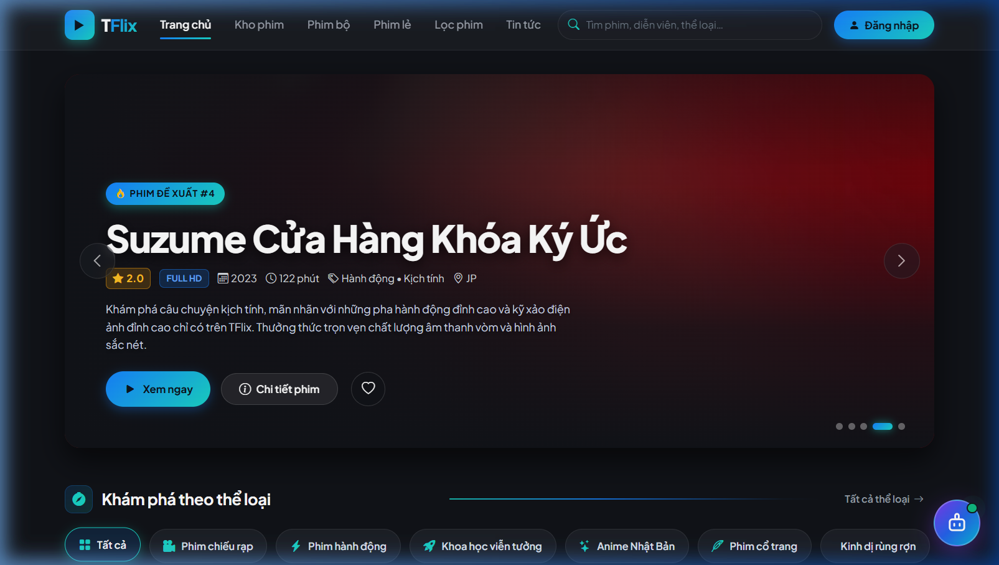
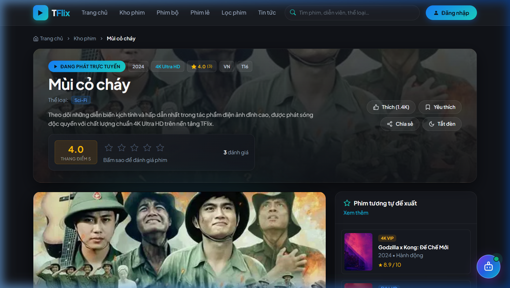
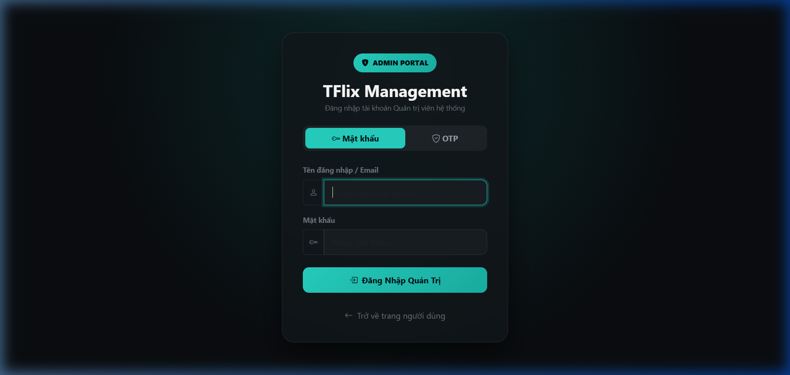
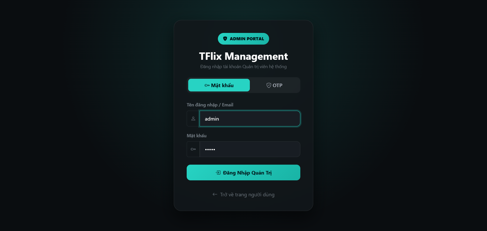

# 🎬 TFlix - Nền Tảng Xem Phim Trực Tuyến & OTT Video Streaming

<p align="center">
  
</p>

<p align="center">
  
  
  
  
  
  
  
  
</p>

---

## 📖 Giới Thiệu Dự Án

**TFlix** là nền tảng xem phim trực tuyến đa phương tiện (OTT Video Streaming Platform) chuẩn công nghiệp, được xây dựng trên nền tảng **ASP.NET Core (.NET 8)** theo mô hình kiến trúc nhiều tầng (**Multi-tier Architecture / Clean Architecture**).

Hệ thống cung cấp trải nghiệm giải trí điện ảnh chuẩn rạp với video độ phân giải cao (**HLS / DASH**), giao diện Dark Theme cao cấp, tích hợp **Trợ lý AI tư vấn phim**, quản trị nội dung CMS chuyên nghiệp, cùng cơ chế tải và xử lý video tự động lên Cloud Storage.

---

## 🌟 Tính Năng Nổi Bật (Key Features)

### 1. 🎥 Trình Phát Video OTT Hiện Đại (Custom Video Player)
- **Chuẩn Streaming Quốc Tế**: Hỗ trợ luồng **HLS (.m3u8)** thích ứng bitrate tự động theo tốc độ mạng người dùng, fallback sang MP4 CDN chất lượng cao.
- **Tối ưu cảm ứng di động (Mobile First)**:
  - Chạm 1 lần vào màn hình: Hiện thanh điều khiển và tự ẩn sau 3.5 giây.
  - Chạm lần 2 (nhấn lại): Ẩn ngay lập tức thanh điều khiển để không che phụ đề.
  - Chống lag, chống kích hoạt nhầm khi vuốt cuộn màn hình.
- **Đầy đủ phím tắt & tính năng rạp**: Phím tắt tua `J`/`L` (10s), Play/Pause `Space`/`K`, Fullscreen `F`, Mute `M`, Chế độ xem rạp (Theater mode), điều chỉnh tốc độ từ 0.5x đến 2.0x, chuyển đổi nguồn phát (Server dự phòng).
- **Lưu tiến trình xem (Watch Progress)**: Tự động ghi nhớ thời điểm đã xem để xem tiếp trên thiết bị khác.

### 2. 🤖 Trợ Lý Tư Vấn Phim AI (TFlix AI Chatbot)
- **Tư vấn điện ảnh thông minh**: Tích hợp trí tuệ nhân tạo thế hệ mới kết hợp trực tiếp dữ liệu từ TFlix Database để gợi ý phim chuẩn xác theo thể loại, tâm trạng, quốc gia, diễn viên.
- **Thẻ phim trực quan (Interactive Movie Cards)**: Hiển thị poster, điểm đánh giá và nút xem ngay bên trong khung chat.
- **Đồng bộ hội thoại**: Lưu lịch sử trò chuyện qua API backend kết hợp LocalStorage để không bị mất ngữ cảnh khi chuyển trang.

### 3. ⭐ Hệ Thống Đánh Giá Sao (Star Rating) & Yêu Thích
- Đánh giá từ 1 đến 5 sao tại **Trang chủ**, **Trang xem phim** và **Trang chi tiết phim sắp chiếu**.
- Lưu trữ điểm trung bình và tổng lượt đánh giá, đồng bộ tức thì không cần reload trang.
- Thêm/xóa phim khỏi danh sách **Phim yêu thích (Watchlist)** với 1 cú click.

### 4. 🗄️ Quản Trị Hệ Thống Toàn Diện (Admin Dashboard)
- **Quản lý danh mục phim**: Thêm, sửa, xóa, duyệt trạng thái phim lẻ (Movie) và phim bộ (Series, Season, Episode).
- **Tải lên & Xử lý Video (Media Transcoding)**: Hỗ trợ upload video gốc, tự động phân đoạn sang HLS đa độ phân giải (360p, 720p, 1080p, 4K) và đồng bộ lên **Cloudflare R2** / Bunny Stream.
- **Phân quyền người dùng (RBAC)**: Quản lý vai trò (Admin, Content Manager, Member) và thiết bị đăng nhập.

---

## 🖼️ Ảnh Chụp Giao Diện Thực Tế (Screenshots)

### 1. Trang Chủ Hiện Đại (Home Page)
> Giao diện chuẩn Cinematic với Hero Banner chuyển động, phim hot hôm nay, bảng xếp hạng Top 5 và bộ lọc thể loại đa dạng.


---

### 2. Trình Phát Video Trực Tuyến (OTT Streaming Player)
> Giao diện phát phim trực quan, thông tin diễn viên, danh sách tập phim, đánh giá sao và cụm bình luận thời gian thực.



---

### 3. Hệ Thống Quản Trị TFlix (Admin Portal)
> Giao diện trang quản trị trực quan, bảo mật cao dành cho bộ phận vận hành nội dung và hệ thống.



---

### 4. Quản Lý Upload & Chuyển Đổi Media (Video Upload & HLS)
> Hệ thống xử lý video chuyên dụng, tích hợp Cloudflare R2 Storage và mã hóa chuẩn streaming.



---

### 5. Tài Liệu OpenAPI / Swagger RESTful API
> Hệ thống Backend REST API chuẩn hóa, tài liệu tương tác trực tiếp qua Swagger UI.


Dự án được cấu trúc thành các tầng độc lập nhằm đảm bảo tính mở rộng cao:

```text
TFlix/
├── CommonLib/            # Thư viện dùng chung (Helpers, Extensions, DTO dùng chung, File Logging)
├── CoreLib/              # Tầng Business Logic (Services, Models, Domain Rules, Validations)
├── DataServiceLib/       # Tầng Data Access (Repository Pattern, SQL Server Providers, SP Caller)
├── Server/               # REST API Backend (Controllers, JWT Auth, Stream API, Payment API)
├── WebBrowser/           # Frontend MVC (Controllers, Razor Views, Bootstrap 5 UI, Custom CSS/JS)
├── Database/             # Toàn bộ mã nguồn Stored Procedures, Scripts CSDL
├── docs/                 # Tài liệu hướng dẫn và hình ảnh minh họa
├── docker-compose.yml    # Cấu hình triển khai container hóa
└── TFlix.sln             # Solution chính của dự án
```

---

## ⚙️ Yêu Cầu Môi Trường (Prerequisites)

- **Hệ điều hành**: Windows 10/11, macOS hoặc Linux.
- **SDK**: [.NET 8.0 SDK](https://dotnet.microsoft.com/download/dotnet/8.0) trở lên.
- **Cơ sở dữ liệu**: Microsoft SQL Server 2019/2022 (hoặc Azure SQL).
- **Caching**: Redis Server 6.0 trở lên.
- **Cloud Storage** (Tùy chọn): Cloudflare R2 / AWS S3 tương thích.

---

## 🚀 Hướng Dẫn Cài Đặt & Chạy Dự Án (Quick Start)

### Bước 1: Clone Repository
```bash
git clone https://github.com/thanhtunglk231/TFlix.git
cd TFlix
```

### Bước 2: Thiết Lập Cơ Sở Dữ Liệu
1. Mở SQL Server Management Studio (SSMS) hoặc Azure Data Studio.
2. Tạo cơ sở dữ liệu `TFlix`.
3. Chạy các file kịch bản bảng và Stored Procedures trong thư mục `Database/StoredProcedures/`.

### Bước 3: Cấu Hình `appsettings.json`
Cấu hình chuỗi kết nối và các dịch vụ trong file `Server/appsettings.json` và `WebBrowser/appsettings.json`:
- **DefaultConnection**: Kết nối tới SQL Server của bạn.
- **Redis**: Địa chỉ Redis Server (mặc định `localhost:6379`).
- **Gemini:ApiKey**: Khóa API Google Gemini dành cho Chatbot AI.
- **CloudflareR2**: Cấu hình S3/R2 Endpoint, BucketName, AccessKey, SecretKey.

### Bước 4: Khôi Phục Gói & Biên Dịch
```bash
dotnet restore
dotnet build
```

### Bước 5: Khởi Chạy Hệ Thống

> **Lưu ý**: Khởi chạy **Server API** trước khi chạy **WebBrowser MVC**.

#### 1. Khởi chạy Server Backend API:
```bash
dotnet run --project Server/Server.csproj --launch-profile http
```
- **REST API Base URL**: `http://localhost:5035` (hoặc cấu hình trong launchSettings)
- **Swagger Documentation**: `http://localhost:5035/swagger/index.html`

#### 2. Khởi chạy WebBrowser MVC (Frontend):
Mở một cửa sổ Terminal mới:
```bash
dotnet run --project WebBrowser/WebBrowser.csproj --launch-profile http
```
- **Trang web người dùng**: `http://localhost:5121`
- **Trang quản trị Admin**: `http://localhost:5121/Admin`

---

## 🛡️ Công Nghệ & Thư Viện Sử Dụng (Tech Stack)

| Hạng mục | Công nghệ sử dụng |
| :--- | :--- |
| **Backend Framework** | ASP.NET Core 8.0 (C# 12) |
| **Kiến trúc** | Multi-tier Clean Architecture, Repository Pattern, Service Layer Pattern |
| **Frontend UI** | ASP.NET Core Razor Pages, Bootstrap 5.3, Vanilla JavaScript, CSS3 Grid/Flexbox |
| **Cơ sở dữ liệu** | Microsoft SQL Server (Stored Procedures tối ưu hiệu năng) |
| **Bộ nhớ đệm (Cache)** | Redis (StackExchange.Redis) |
| **Video Streaming** | HLS (.m3u8), Hls.js, HTML5 Video API, MP4 Video Stream |
| **Trí tuệ nhân tạo (AI)** | Google Gemini Generative AI Model |
| **Lưu trữ đám mây** | Cloudflare R2 (S3 Compatible Storage) |
| **Tài liệu API** | OpenAPI 3.0 / Swashbuckle Swagger |
| **Bảo mật** | Cookie Authentication, JWT Bearer Token, Anti-Forgery Token, Role-Based Access Control |

---

## 👨‍💻 Tác Giả & Bản Quyền

- Dự án được phát triển bởi **Thanh Tùng** ([@thanhtunglk231](https://github.com/thanhtunglk231)).
- Mọi đóng góp (Pull Request, Issue) đều được chào đón nhằm nâng cao chất lượng nền tảng.
- Giấy phép sử dụng: [MIT License](LICENSE).
